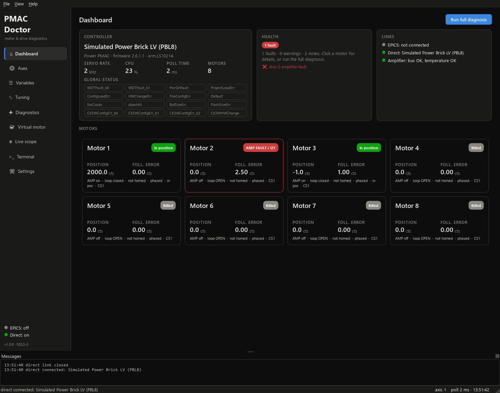
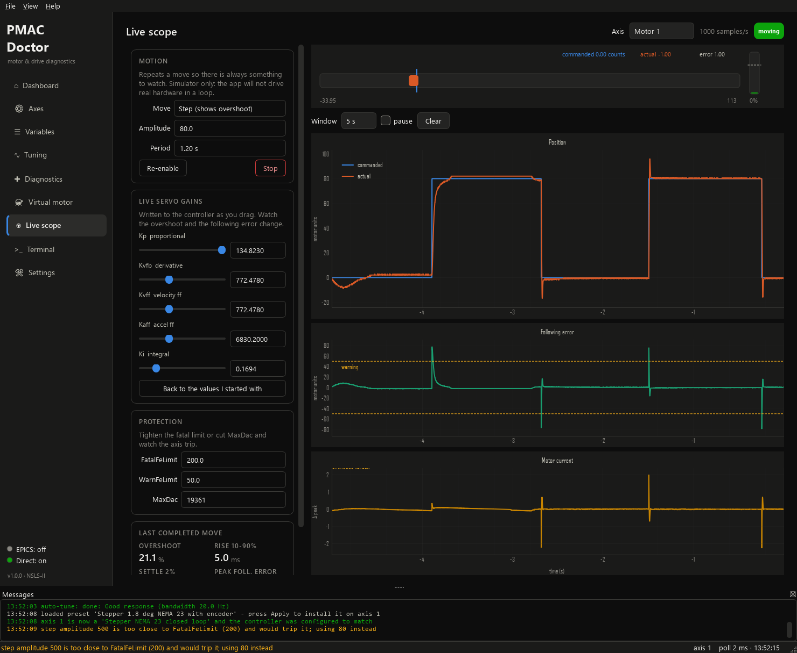

# PMAC Doctor

Windows diagnostic and tuning assistant for Delta Tau / Omron **PMAC** motion controllers
(Power Brick LV, Power Brick AC, CK3E/UMAC Power PMACs, and Turbo PMAC / Geobrick) that are
run from EPICS IOCs built on the [DiamondLightSource `pmac`](https://github.com/DiamondLightSource/pmac)
driver.

It answers three questions quickly:

1. **What is the controller / motor configured as?** - every important `Motor[x].`, `Sys.`,
   `BrickLV.`, `PowerBrick[i].Chan[j].`, `EncTable[n].` element (Power PMAC) or `Ixx00-Ixx99`,
   `I0-I99`, `I7mn0-9` variable (Turbo), with description, default, equivalent, P/Q/M ranges,
   export and baseline comparison.
2. **Why is the motor misbehaving?** - a rule engine decodes status words, motor-record data
   and the configuration dump and lists ranked findings with *probable causes* and *actions*
   (amp faults, I2T, following error, phasing, encoder loss, limits wiring, bus voltage,
   watchdog, EPICS/controller unit mismatches, ...), referencing the Power Brick LV manual.
3. **Is the servo tuned?** - step-response capture with metrics and recommendations, the
   open-loop test (sign/commutation/encoder check), model-based **auto-tune** (plant
   identification -> PID design -> verification iterations) and a current/I2T calculator that
   implements the manual's MaxDac / I2TSet / I2tTrip / PwmSf formulas.

4. **What if I had this motor?** - the **Virtual motor** page turns the built-in simulator into a
   specific stepper or servo from its datasheet (torque constant, inertia, friction, winding R/L,
   encoder resolution, screw and gearbox), derives the plant, optionally configures the simulated
   PMAC to match, and injects faults on demand. Steppers lose steps and stall exactly like the
   real thing.
5. **Show me it moving** - the **Live scope** repeats a move and plots commanded against actual
   position, following error against its warning and fatal limits, and current against I2TSet and
   MaxDac, at the servo rate. Drag the Kp slider and watch the overshoot grow; tighten
   FatalFeLimit and watch the axis trip.

Everything also works without hardware thanks to a built-in Power Brick LV / Geobrick simulator
with fault scenarios (`Settings -> Built-in simulator`).





## Connections

| Link | What it gives | Notes |
|---|---|---|
| **EPICS (Channel Access)** | status words, positions, following errors, PLC/program bits, CPU load, comms statistics, motor records (`RBV`, `MSTA`, `MRES`, limits, ...), `SendCmd` | prefix = `$(P)` of `pmacController.template`; motor records default to the `$(P):M<n>` aliases of `dls_pmac_asyn_motor.template` (template configurable) |
| **Power PMAC direct (SSH / gpascii)** | full variable access, data gather, tuning tests | default `root` / `deltatau`, port 22 - the same channel the IOC uses |
| **Turbo PMAC direct (Ethernet 1025)** | full I/P/M/Q access, polling-based tuning tests | Delta Tau Ethernet protocol (`VR_PMAC_GETRESPONSE`) |
| **Simulator** | all of the above, no hardware | scenarios: `i2t_trip`, `encoder_loss`, `limits_not_wired`, `wrong_feedback_sign`, `not_phased`, `oscillating`, `sluggish`, `bus_undervoltage`, `watchdog`, `saturating`, `resonance` |

Both links can be active at once: EPICS gives the beamline view, the direct link the deep view.
The `SendCmd` PV of the Diamond driver is write-only, so with EPICS alone the Variables and
Tuning pages are read-only / disabled.

## Install (end users)

Run `PmacDoctor-<version>-setup.exe` (per-user install, no admin needed) or unzip the portable
zip and start `PmacDoctor.exe`. Windows 10/11 x64.

Command-line shortcuts: `PmacDoctor.exe --simulate [scenario]`, `--epics <prefix>`, `--ssh <host>`.

## Run from source

```powershell
.\run_dev.ps1            # creates .venv on first use, installs requirements.txt, starts the app
```
Python 3.8 - 3.12. Dependencies: PySide6, pyqtgraph, numpy, scipy, pyepics, paramiko, pillow.

## Build the installer

```powershell
powershell -ExecutionPolicy Bypass -File build\build.ps1
```
Runs the unit tests, freezes the app with PyInstaller, zips a portable copy and compiles
`installer\PmacDoctor.iss` with Inno Setup. The two deliverables land in
`dist\PmacDoctor-<version>-portable.zip` and `dist\installer\PmacDoctor-<version>-setup.exe`.
If Inno Setup is not installed the script installs it *portably* into `tools\InnoSetup` from
`tools\downloads\innosetup-*.exe`.

The unpacked application is built in `%LOCALAPPDATA%\PmacDoctor-build\dist\PmacDoctor`, not in
the project. This project lives in a OneDrive folder, and the sync client locks files while
PyInstaller is writing them, which breaks both the build and any attempt to mirror the result
back. For the same reason, never edit the sources with a Windows PowerShell `Get-Content -Raw` /
`Set-Content` one-liner: PowerShell 5.1 reads BOM-less UTF-8 as cp1252 and the round trip
double-encodes every non-ASCII character. `tools\fix_encoding.py` detects and reverses that.

## Tests

```powershell
.venv\Scripts\python -m pytest tests\test_core.py -q     # core: parsing, rules, tuning math, simulator
.venv\Scripts\python tests\ui_smoke.py                   # headless GUI run, screenshots in tests\screenshots
```

## Layout

```
pmacdoctor/
  comm/      base.py (link protocol), ssh_power.py, ethernet_turbo.py, epics_client.py,
             simulator.py, session.py (poll / dump / acquire)
  core/      knowledge.py (variable database), status_bits.py, units.py (I2T formulas),
             rules.py (diagnostic engine), tuning.py (metrics, plant ID, PID design),
             motor_model.py (datasheet -> plant + PMAC settings), autotuner.py, models.py
  ui/        theme.py, widgets.py, pages/*  (PySide6)
build/       PyInstaller spec + build.ps1       installer/  Inno Setup script
docs/        USER_GUIDE.md                      reference/  manual text extract & driver notes
```

## Safety

Tuning tests, jogs, homing and phasing **move the motor**. The app asks for confirmation (can be
disabled in Settings), never writes to flash (`save` must be typed in the Terminal) and keeps the
previous gains for one-click restore. Always have the axis free to move, limits working and
`FatalFeLimit` set before tuning.

## References

* Power Brick LV ARM User Manual, Delta Tau / Omron, MN-000143 rev F (2022) - formulas and
  troubleshooting procedures implemented here (Motor Setup, I2T Protection, Current Loop
  Tuning, Phase Reference, Open Loop Test, Position Loop Tuning, Encoder Loss Detection,
  BrickLV structure elements, Watchdog Faults).
* DiamondLightSource/pmac EPICS module - PV names, status word bit mapping, `cid` detection.
* Power PMAC / Turbo PMAC Software Reference Manuals - status bits and variable semantics.
